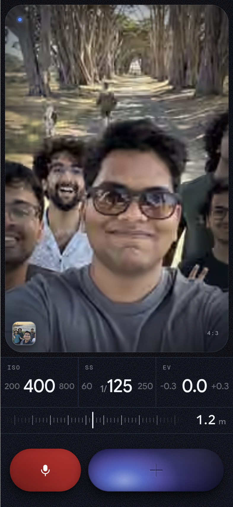
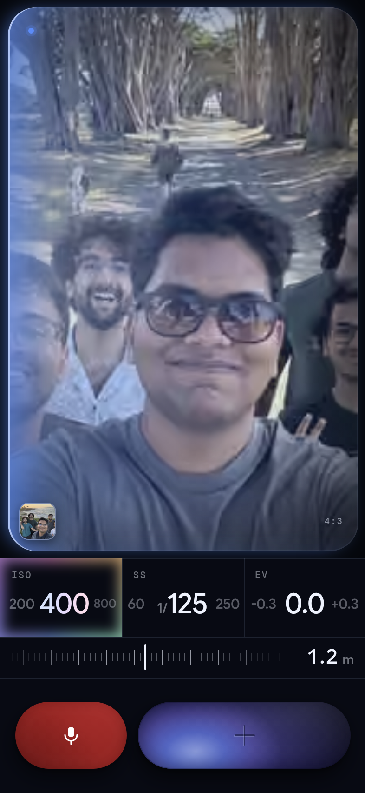
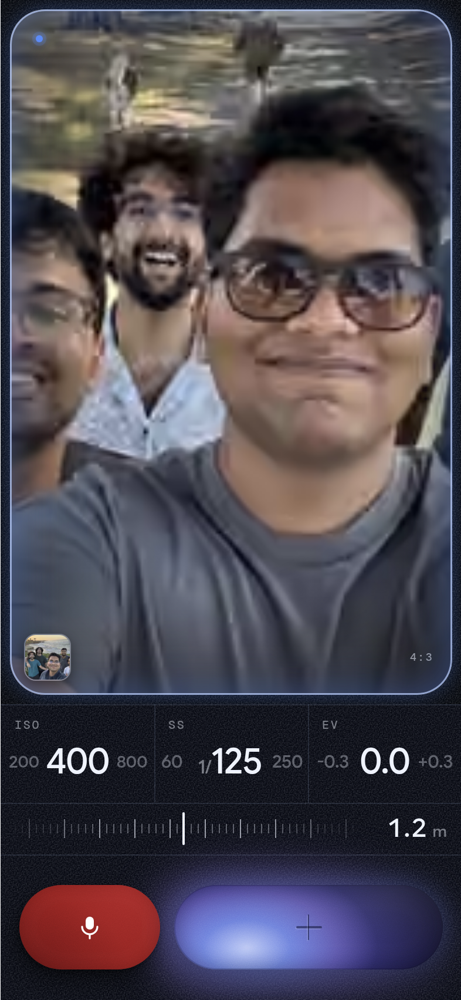
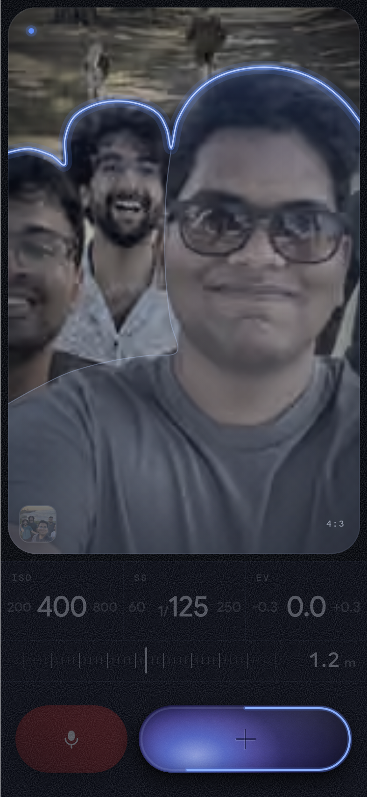
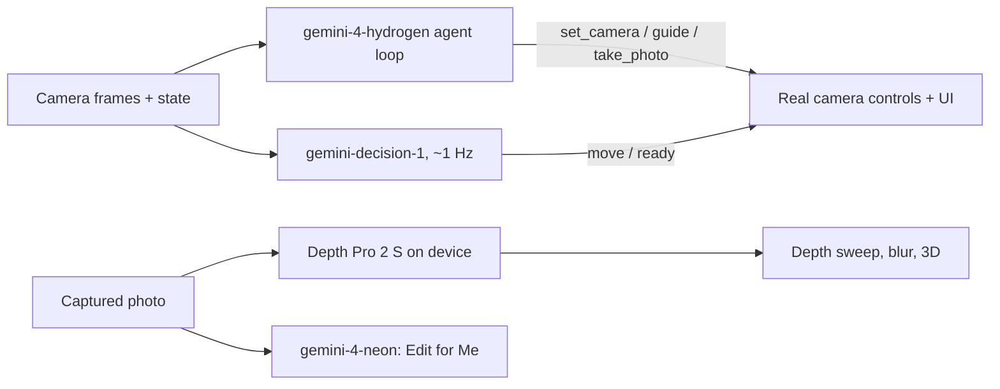

<p align="center">
  
</p>

<h1 align="center">Heliocam</h1>

<p align="center">
  <b>The iPhone camera that knows which dial to turn, and turns it.</b><br>
  Gemini 4 watches the viewfinder, moves the real ISO, shutter, focus and white-balance controls,
  tells you where to step, and says <i>"That's it, take it."</i> when the shot is right.
</p>

<p align="center">
  <a href="https://helio.pranavkarra.me/"><b>helio.pranavkarra.me</b></a>
  · Built at the Gemini 4 NYC Hackathon (2026-11-21)
</p>

<table align="center">
  <tr>
    <td align="center"><br><sub>Watching the scene</sub></td>
    <td align="center"><br><sub>Gemini turns a dial</sub></td>
    <td align="center"><br><sub>Aligned: take it</sub></td>
    <td align="center"><br><sub>Depth scan</sub></td>
  </tr>
</table>
<p align="center"><sub>Design mockups of the app's v2 "instruments" UI (<code>design/handoff/mocks/iphone/</code>).</sub></p>

## What it does

- **A camera agent, not a photo filter.** A Gemini 4 loop looks at the live frame and the camera's
  state and calls tools: `set_camera` (ISO, shutter, EV, focus, white balance, zoom, torch),
  `guide` (where to move), `set_intent`, `shot_ready` and `take_photo`. The dials on screen roll
  when Gemini moves them, and a ghost target frame shows how far to move the phone.
- **Fast decisions every second.** Next to the agent, `gemini-decision-1` answers the quick
  questions about once a second: which way to move (the viewfinder's edge glows that way), whether
  the shot is ready, and how the user reacted.
- **It talks.** On-device speech recognition hears you; the coach answers with Gemini TTS.
- **Depth on the phone.** Apple's Depth Pro 2 S runs on device through Core ML (LiDAR depth is the
  fallback), so every shot has metric depth: a depth sweep after capture, depth blur, and a 3D view.
- **Edit for Me.** Gemini 4 plans an edit and plays it as a sequence of moves on six faders you
  can watch. Hold to talk: "make it warmer" maps to a fader move instantly.

Everything runs on the iPhone. There's no server: the app calls the Gemini API directly.

## Gemini models and their jobs

| Model | Job |
|---|---|
| `gemini-4-hydrogen` | The live camera agent: function calling over the camera frame and state |
| `gemini-decision-1` (Decisions API) | ~1 Hz `move` / `ready` / `reaction` calls; instant fader moves from voice |
| `gemini-4-neon` | Edit for Me: plans the edit as fader moves |
| `gemini-3.8-flash-tts` | The coach's voice |
| Depth Pro 2 S (Core ML, on device) | Metric depth for every shot; LiDAR as fallback |



## Run it

> **Heliocam must be installed on your own iPhone from your Mac.** It isn't on the App Store or
> TestFlight: build it in Xcode and run it on your device with the steps below.

You need a Mac with Xcode, [XcodeGen](https://github.com/yonaskolb/XcodeGen), [uv](https://docs.astral.sh/uv/)
and an iPhone (a LiDAR model gets the depth fallback).

```sh
# 1. Your Gemini API key (gitignored)
echo 'GEMINI_API_KEY = <your key>' >> apple/Local.xcconfig

# 2. The on-device depth model (51 MB, gitignored; the app falls back to LiDAR without it)
uv run tools/depthpro2_coreml/fetch.py

# 3. Generate the Xcode project and open it
cd apple/CoachCam && xcodegen generate && open CoachCam.xcodeproj
```

Signing with a free Apple ID and running on your phone: [`apple/CoachCam/README.md`](apple/CoachCam/README.md).

## Repo layout

| Path | What |
|---|---|
| `apple/CoachCam/` | The iPhone app |
| `apple/CoachKit/` | Shared Swift packages: models, Gemini clients, the live loop, the edit renderer, UI controls |
| `tools/depthpro2_coreml/` | Fetches the Core ML Depth Pro 2 S model; PyTorch parity check |
| `design/` | The design spec (`V2_INSTRUMENT.md`), handoff, mockups, icons and shaders |
| `experiments/` | Film-look LUTs and earlier mask/review experiments |
| `web/public/samples/` | Sample photos used by the Swift tests |

## Working in this repo

Read [CONTRIBUTING.md](CONTRIBUTING.md) before you contribute. The rules are the same for people and
agents: every task starts as a GitHub issue, all work happens in a worktree, and changes reach `main`
only through squash-merged PRs.

Sample photos in `web/public/samples/` are from the wayback project. Depth Pro 2 weights are under
Apple's AMLR license (research use).
