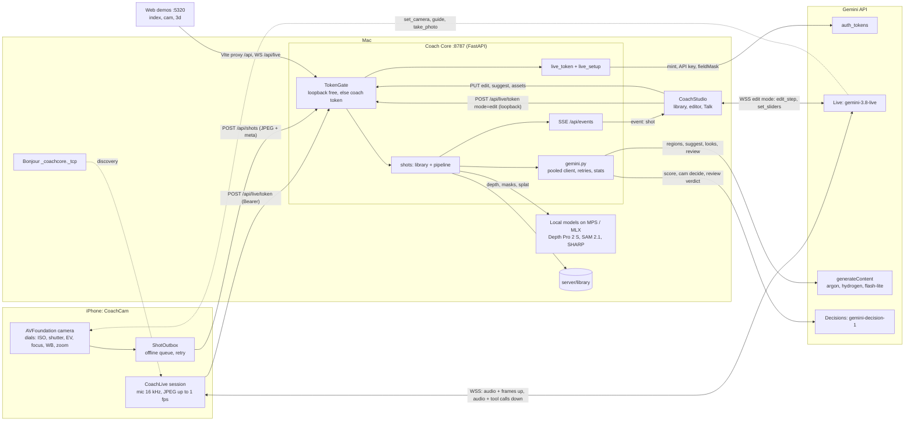

# Architecture

Coach is a camera and a darkroom with Gemini in both, split across two devices:

- **The iPhone (CoachCam)** is a native camera with real manual controls shown as dials. A Gemini
  Live session sees ~1 fps frames, hears the user, coaches by voice and turns the dials itself
  (`set_camera`). Shots sync to the Mac.
- **The Mac** runs **Coach Core** (`server/`, FastAPI on :8787), which owns the API key, the local
  models (Depth Pro, SAM 2.1, SHARP) and the shot library. **CoachStudio** (the Mac app) supervises
  Core, shows the library live and edits shots with Paper-style sliders that Gemini can drive and
  use to teach.
- **Audio and video never go through Core.** Core mints a short-lived Live token with the whole
  session setup locked inside it, and the apps talk to Gemini directly. Core makes every other
  Gemini call (generateContent, Decisions, TTS) through one client, `server/gemini.py`.

Specs: `docs/CORE_API.md` (source of truth for the apps), `CONTRACT.md` and `CAM_CONTRACT.md` (older
endpoints and the web camera), `docs/BEST_PRACTICES.md` (every Gemini call: settings, docs, cost),
`design/DESIGN.md` (tokens and controls).

## 1. Data flows

The four flows, in order of use:

1. **Shoot with a coach (iPhone ↔ Gemini Live).** CoachCam asks Core for a token
   (`POST /api/live/token`, `mode: camera`). Core builds the setup in `live_setup.py` (prompt,
   tools, VAD, transcription, compression, media resolution) and mints a 1-use token with every
   field locked except `sessionResumption`. The phone opens the WebSocket itself, sends 40 ms mic
   chunks and a JPEG only when the picture changed (≤1 fps), plays 24 kHz audio, and executes tool
   calls in arrival order: `set_camera` moves AVFoundation and animates the dial, `take_photo`
   captures. Reconnects resume the same conversation with the last handle.
2. **Sync and process (iPhone → Core → local models and Gemini).** `take_photo` writes the shot to
   disk, then `POST /api/shots` uploads it with the capture settings and coach lines. Core stores
   `original.jpg`, makes `image.jpg` (1536 px, upright) and `thumb.jpg`, answers 201 in ~0.1 s, and
   runs the pipeline in the background, newest shot first: **depth ∥ score ∥ regions → masks ∥
   suggest**. GPU stages (Depth Pro, SAM, SHARP) share one lock. Every status change is persisted
   to `shot.json` and broadcast.
3. **Library sync (Core → Mac app, SSE).** CoachStudio holds `GET /api/events` open. Each `event:
   shot` carries the full record, so stage dots fill in live and a new iPhone shot slides in
   without polling. The stream reconnects on its own; `hello` triggers one full reload.
4. **Edit with Gemini (Mac app ↔ Core ↔ Gemini).** "Coach me" plays `suggest.json` (3–8 steps in
   editing order) through the slider panel. "Talk" mints an edit-mode token: Core bakes the shot's
   regions, scores, depth summary, plan and current slider values into the prompt, and Gemini moves
   sliders with `edit_step`/`set_sliders`, explaining each move. Rendering is local:
   `CoachEdit` (Core Image on Metal) with `depth.png` and the subject's SAM mask. Save is
   `PUT /api/shots/{id}/edit`.

## 2. Components

### Coach Core (`server/`, Python 3, FastAPI, uv)

| Module | Role | Models |
|---|---|---|
| `app.py` | App, ASGI token gate (HTTP + WS), `/api/health`, `/api/pair`, LAN token file, Bonjour, stateless `/api/depth`, `/regions`, `/masks`, `/score`; auto-includes the routers below | – |
| `gemini.py` | The one Gemini REST client: pooled HTTP/1.1 per event loop, retries 429/5xx/network with backoff + jitter honouring `Retry-After` inside one deadline, one `coach.gemini` log line per call, per-model/tag stats. Helpers `generate[_json]`, `decisions`, `tts`, `mint_live_token` | – |
| `stats.py` | `GET /api/stats` (p50/p95, tokens, estimated cost per model and tag), `DELETE` resets | – |
| `live_setup.py` | Builds the Live setup for camera and edit mode; `token_constraints` produces the fieldMask | gemini-3.8-live |
| `live_token.py` | `POST /api/live/token` | auth_tokens |
| `shots.py` | Library, background pipeline, `GET /api/events` SSE, edit save, suggest endpoint, splat request. Single owner per library (`flock`); a second process serves read-only | – |
| `depth.py` | Metric depth, 512 px float32, LRU by image bytes | Apple Depth Pro 2 S (MPS fp16) |
| `segment.py` | Region masks from boxes, trimmed by depth | SAM 2.1 hiera-large (MPS fp16) |
| `regions.py` | Three coaching regions with `box_2d` boxes; OpenRouter fallback | gemini-4-argon |
| `decide.py` | Lighting + composition scores (both rubrics in one request) and labels | gemini-decision-1, gemini-3.5-flash-lite |
| `edit.py` | Edit plan (`suggest`): JSON Schema, clamp, dedupe, sort into editing order | gemini-4-hydrogen |
| `review.py` | `POST /api/review`: instant post-capture verdict and cards as SSE | decision-1, flash-lite, hydrogen (refine) |
| `looks.py` | Per-photo film looks: compiles Gemini's recipe into a 33³ LUT + effects | hydrogen (fit), neon (bold) |
| `semantic.py` | Semantic masks (sky, people, foliage…) and local edit layers | hydrogen + SAM + Depth Pro |
| `splat.py`, `splat_worker.py` | SHARP Gaussian splats (MLX, separate long-lived worker) and `/api/reframe` | SHARP, hydrogen |
| `cam.py` | Web camera brains: `WS /api/live` proxy (key stays on Core), `/api/cam/decide`, `/understand`, `/say` | 3.8-live, decision-1, hydrogen, 3.8-flash-lite-tts |
| `checks/` | One script per feature (`shots_check`, `live_token_check`, `cam_check`, …), `bench.py`, `live_cost.py` | – |

### CoachKit (`apple/CoachKit`, Swift package, iOS 18 / macOS 15, language mode 5)

| Target | What it is | Used by |
|---|---|---|
| `CoachModels` | Codable types for every Core shape: shots, assets, recipe (incl. `look`), sliders with ranges/snapping, Live tool args, pairing URL | everything |
| `CoachAPI` | `CoachClient` actor (Bearer only to Core's own host, typed errors, multipart), SSE parser, `events()` stream with reconnect (stops on 401), Bonjour discovery, Keychain `PairingStore` | both apps |
| `CoachLive` | `LiveSession` (handshake, resumption, goAway handling, re-mint on refused resume, ordered sends), `LiveAudio` (voice-processing mic in 40 ms chunks, gapless 24 kHz playback, barge-in flush), `LiveFrames` (luma change gate, ≤1 fps JPEG) | both apps |
| `CoachEdit` | `EditRenderer`: Metal `CIContext` pipeline for every §4 slider, crop/straighten, depth blur from `depth.png`, subject masks, film looks (LUT + grain/halation/bloom) | CoachStudio |
| `CoachUI` | DESIGN.md tokens, `CameraDial`/`CameraDialStrip` (momentum, detents, haptics, amber coach glide with "why"), `EditSliderRow`/`EditSliderPanel` (`play(EditSuggestion)`, `coachStep`), `GuideArrow`, `ShutterButton` | both apps |

### CoachCam (`apple/CoachCam`, iPhone, XcodeGen)

`App/` (model, routing), `Camera/` (`AVCaptureEngine` drives ISO/shutter, EV, focus, WB gains,
zoom ramp, torch/flash, portrait/night/macro presets, reports clamped values; `MockCaptureEngine`
for the Simulator), `Coach/` (`CoachSession`: token, Live, tools in order, 4 s check-ins only when
the scene changed, user dial moves sent as silent context), `Sync/` (`ShotOutbox`), `Pairing/`
(Bonjour, QR scanner, `coach://pair` URL scheme), `UI/`, `Debug/` (launch arguments). Details:
`apple/CoachCam/README.md`.

### CoachStudio (`apple/CoachStudio`, macOS, XcodeGen)

`CoreSupervisor` (reuses a running Core, else starts `uvicorn` with `COACH_LAN=1` and stops it on
quit), `LibraryStore`/`LibraryView` (SSE-driven grid, drag-drop import), `EditorModel`/`EditorView`/
`PreviewCanvas` (on-demand `MTKView`), `RegionOverlay`, `CoachDock` (Coach me), `TalkController`
(edit-mode Live; slider answers use `WHEN_IDLE`), `DetailsPanel`, `SplatViewer` (embeds the web
`3d.html`), `PairingSheet` (QR from `/api/pair`). Details: `apple/CoachStudio/README.md`.

### Web demos (`web/`, Vite on :5320, proxies `/api` and WS to Core)

`index.html` (lighting coach: photo as depth points, regions, scores), `cam.html` (phone browser
camera coach: `live` engine through `WS /api/live`, fallback `decide` engine), `3d.html` (SHARP
splat viewer with reframe coaching), `lab/engines.html` (dev bus log). They stay as demos and as
the no-install path via `phone.sh`.

## 3. Latency and cost budget

Measured 2026-11-21 on this Mac (Apple silicon, models on MPS), real Gemini calls. Ranges span
the build and verify runs; n is small, and Gemini's own queueing moves REST p50s by −26% to +18%
between runs.

| Step | Measured | Gemini cost |
|---|---|---|
| **Live (camera)** | | |
| Mint token (`/api/live/token`) | 0.09–0.27 s | – |
| WebSocket `setupComplete` | 0.19–0.41 s | – |
| App start → live | 0.44–0.60 s (Simulator 0.55–0.58 s) | – |
| Request → tool call | 0.4–1.0 s (typed "warmer, portrait, take it" → `set_camera` + `take_photo` 0.64 s) | – |
| Request → first audio | 1.0–1.3 s | – |
| Drop → resumed, conversation kept | 0.3–0.7 s | – |
| Frame gate / JPEG on phone | ~0.2 ms / 6–9 ms (only frames that are sent) | ~165 tokens per frame |
| Active framing, 1 fps + 4 s check-ins | – | ~180k input tokens/min ≈ $0.17/min (~$10/h) |
| Static scene (no new frames) | – | ≈ $0.02/min |
| **Live (edit, Mac)** | | |
| Live → first slider move | 0.72 s; "make it warmer" → warmth 20 in 0.53 s | well under $0.01/min (no video) |
| **Shot pipeline (Core)** | | |
| Upload `POST /api/shots` | 0.10–0.25 s (201) | – |
| Depth (Depth Pro) | 0.3–0.6 s warm; up to 4 s on a new image shape | local |
| Score (Decision 1 + labels) | 0.84 s p50 (1.17 s in the E2E run) | ≈ $0.0004 |
| Regions (Argon) | 9.5 s p50, 6–25 s spread | ≈ $0.006 (doubles 2026-12-01) |
| Masks (SAM) | 1.6 s warm, 3.8 s cold, 13.5 s on first model load | local |
| Suggest (Hydrogen) | 4.7–9.2 s; saved plan 3–6 ms; with a goal 6.3–7.0 s | in the E2E total below |
| All stages done after upload | 21–23 s (SAM loaded), 32 s fully cold; suggest no longer waits for masks (#8), which saves the SAM time, 2.5–3 s warm | E2E run: 9 calls, $0.025 total |
| SHARP splat (on request) | 7–12 s, ~9 GB, one at a time | local |
| `PUT edit` / health | 3 ms / 3 ms | – |
| **Editing (CoachEdit, 1280 px, all sliders)** | | |
| Render | GPU 2.1–3.2 ms median; wall 4–7 ms (9–14 ms under load) | – |
| Changing `depth_blur` / full export | 10–19 ms / 35–280 ms | – |
| **Web camera fallback (`decide` engine)** | | |
| `/api/cam/decide` / `understand` / `say` | 0.39 s / 4.7 s / 2.4 s (TTS cache hit 15 ms) | ≈ $0.12/min total, 90% understand |
| **Instant review** (`/api/review`, from experiments/review) | decision ~0.6 s, first card ~1.1 s, final ~1.2 s, refine ~5 s | – |

Levers and open items are ranked in `docs/BEST_PRACTICES.md` §7. Two budget facts to keep in mind:
Live bills every turn for the whole context window (capped at 16k, sliding back to 8k), so check-in
frequency is the main cost dial; and Tier 1's $10-per-10-minutes limit is hit by about five phones
framing at once. Implicit prompt caching never applies (REST prompts are 0.6–2.2k tokens; Gemini 4
needs ≥ 4,096).

## 4. Security model

- **API keys stay in Core.** `GEMINI_API_KEY` and `OPENROUTER_API_KEY` live in `.env` (gitignored)
  and are read only by Core (`server/app.py` loads them) and its check scripts. They are never sent to a client, put in an app bundle or
  the web bundle, or logged. Swift integration tests read `GEMINI_API_KEY` from the environment
  only, and only with `COACH_IT=1`.
- **Apps hold only ephemeral Live tokens.** `uses: 1`, `expireTime` 30 min (`LIVE_TOKEN_TTL_MIN`),
  a new session must start within 120 s (`LIVE_TOKEN_START_S`), and the fieldMask locks model,
  prompt, tools and every other setup field. A leaked token can only run the coach it was minted
  for, once, and resume that session until it expires. Browsers use the `WS /api/live` proxy,
  where the key stays on Core.
- **Core's gate** (`TokenGate`, pure ASGI, every HTTP and WebSocket path):
  - Direct loopback requests (the Mac itself) pass, and so do requests the local Vite proxy
    forwards for the Mac (a loopback peer whose `x-forwarded-for` hops are all loopback; Vite
    sets it with `xfwd: true`).
  - Everything else needs the coach token, as `Authorization: Bearer <token>` or cookie
    `coach_k`, compared in constant time. That covers LAN peers (direct or through the Vite
    proxy) and any request carrying `cf-connecting-ip` or `forwarded`, even from loopback, so the
    Cloudflare tunnel can't ride the loopback exemption. `x-forwarded-for` is only trusted from a
    loopback peer.
  - A browser request whose `Origin` isn't localhost / loopback (another website open on the Mac,
    or `Origin: null`) also loses the loopback exemption, so it can't read `/api/pair`'s token,
    upload shots or open Live sessions on Core's key. CORS allows loopback origins only; the coach
    pages are same-origin through Vite and don't need it.
  - Failures get 401 JSON, or WebSocket close 1008.
- **The coach token** is `server/.coach_token` (32 hex chars, chmod 600, gitignored), created on the
  first LAN start, or env `COACH_TOKEN`. It is read on every request, so replacing the file rotates
  it without a restart; phones then show "PAIR AGAIN". CoachCam keeps it in the Keychain and sends
  it only to Core's own host. `phone.sh` reuses an existing token and deletes it on exit only if it
  created it.
- **Pairing info is Mac-only.** `GET /api/pair` answers loopback only (403 otherwise, 409 when LAN
  mode is off).
- **Exposure.** Core binds 127.0.0.1 unless LAN mode is on (`COACH_LAN=1`, 0.0.0.0, Bonjour
  advertisement). LAN traffic is plain HTTP (the apps allow it with `NSAllowsLocalNetworking`), so
  the token crosses the Wi-Fi in the clear: use LAN mode on trusted networks only. The tunnel
  (`phone.sh`) is public HTTPS and token-gated.
- **Data.** Shots stay on the Mac in `server/library/` (gitignored). Images go to Gemini only for
  the calls listed in §2; the phone sends frames and audio straight to Gemini under the token.

## 5. Running it

Prerequisites: `uv` (Python deps from `server/uv.lock`), Node for the web demos, `cloudflared` for
`phone.sh`, Xcode 27.2 and `xcodegen` for the apps, and a `.env` at the repo root with
`GEMINI_API_KEY` (plus `OPENROUTER_API_KEY` for the regions/score fallbacks). SHARP splats need the
wayback checkout with its MLX venv (env `WAYBACK_DIR`).

| Command | What you get |
|---|---|
| `./dev.sh` | Core on 127.0.0.1:8787 and web on :5320. This Mac only, no auth. |
| `./dev.sh lan` | Core on 0.0.0.0 with `COACH_LAN=1`: coach token created, Bonjour advertised, and the iPhone pairing URL and QR printed once Core is up |
| `./phone.sh [cam.html]` | Starts Core and web if needed, opens a Cloudflare quick tunnel and prints a phone URL with `?k=<token>` plus a QR (web camera, no install) |
| `COACH_PORT=8799 ./dev.sh` | Another port; the web proxy follows. For a private test Core: `cd server && COACH_WARMUP=0 uv run --no-sync uvicorn app:app --port 
` with `COACH_LIBRARY=<tmp dir>` |

**Mac app.** `cd apple/CoachStudio && xcodegen generate`, then build with
`DEVELOPER_DIR=/Applications/Xcode.app/Contents/Developer xcodebuild -project CoachStudio.xcodeproj
-scheme CoachStudio -configuration Debug -derivedDataPath build CODE_SIGNING_ALLOWED=NO build` and
`open build/Build/Products/Debug/CoachStudio.app`. It uses a running Core or starts one in LAN mode.
⇧⌘P shows the pairing QR.

**iPhone app with a free Apple ID** (full steps: `apple/CoachCam/README.md`):
1. `cd apple/CoachCam && xcodegen generate && open CoachCam.xcodeproj`.
2. Xcode › Settings › Accounts: add your Apple ID (you get a "Personal Team").
3. CoachCam target › Signing & Capabilities: automatic signing, your Personal Team. If the bundle
   ID `dev.coach.cam` is taken, make it unique. Put `DEVELOPMENT_TEAM = <TEAMID>` in
   `apple/Local.xcconfig` so `xcodegen` doesn't clear it.
4. Plug in the iPhone, trust the Mac, turn on Settings › Privacy & Security › Developer Mode and
   restart.
5. Pick the phone and Run (⌘R). On the first launch, trust the profile in Settings › General ›
   VPN & Device Management, then launch again. Allow Camera, Microphone and Local Network.
6. Start Core in LAN mode (CoachStudio or `./dev.sh lan`) and scan the QR, or pick the Mac from the
   Bonjour list and type the token. Same Wi-Fi required.
7. Free-account signatures expire after 7 days: plug in and Run again.

**Tests.**
- CoachKit: `cd apple/CoachKit && DEVELOPER_DIR=/Applications/Xcode.app/Contents/Developer swift test`
  (the Command Line Tools ship without XCTest/Testing). `COACH_IT=1` adds the integration tests
  against Core and Gemini.
- Core: `cd server && uv run --no-sync python checks/<name>_check.py`, pointed at your own
  instance (`--port`, `--base` or `--url`; see each script's header). All checks passed against
  private instances on 2026-11-21. `checks/bench.py` measures latency; `GET /api/stats` shows calls, p50/p95 and
  cost since start.

Main env knobs: `COACH_PORT`, `COACH_LAN`, `COACH_TOKEN`, `COACH_LAN_HOST`, `COACH_LIBRARY`,
`COACH_WARMUP`, `COACH_HOST` (Vite bind); `LIVE_MODEL`, `LIVE_VOICE`, `LIVE_CWC_TRIGGER`/`TARGET`,
`LIVE_TOKEN_TTL_MIN`, `LIVE_TOKEN_START_S`, `LIVE_MAX_STARTS`, `LIVE_BUDGET_WINDOW_MIN`; `REGIONS_MODEL`, `SUGGEST_MODEL`, `REVIEW_MODEL`,
`REVIEW_REFINE`, `SEMANTIC_TARGETS_MODEL`, `SEMANTIC_PLAN_MODEL`, `UNDERSTAND_MODEL`, `DECIDE_*`;
`DEPTH_DEVICE`/`PRECISION`, `SEGMENT_MODEL`/`DEVICE`/`PRECISION`.

## 6. Known gaps

**Not yet run on hardware.**
- CoachCam has only run in the Simulator, with the mock camera. Untested on a real iPhone:
  AVFoundation manual controls, depth capture, the QR scanner, echo-cancelled audio with 40 ms
  chunks, and the frame gate under real sensor noise.
- CoachStudio's Talk was tested with typed turns, not the mic. The embedded 3D viewer rendered
  black frames in snapshots, and drag-and-drop wasn't automated.

**Built in Core but not wired.**
- `looks.ensure_fit_look` (auto "fit" look after suggest), `semantic.ensure_semantic` (semantic
  masks after masks) and `review.attach` (claim a review by `review_id` on upload) exist but
  `shots.py` doesn't call them yet. All three work on demand.
- `PUT /api/shots/{id}/edit` stores only `values`, `subject` and `crop`. A recipe's `look` (which
  CoachModels and CoachEdit support) and `layers` (§7) are dropped on save.
- Neither app calls `/api/review`, `/looks` or `/semantic` yet. CoachCam doesn't render edits
  (CoachEdit builds for iOS but only CoachStudio uses it).

**Cost and speed.**
- The Live spend guard (`LIVE_MAX_STARTS` per `LIVE_BUDGET_WINDOW_MIN`, CORE_API §2) caps
  session starts, not minutes: a few long sessions can still add up. CoachLive ignores
  `usageMetadata`, so Core can't meter actual spend.
- Check-ins every 4 s dominate Live cost; the web live client has no frame change gate and ticks
  regardless.
- `/api/cam/understand` could move to Flash-Lite (1.1 s vs 4 s, ~8× cheaper) once checked on
  real voice clips.
- Argon (regions) doubles in price on 2026-12-01.

**Operations.**
- Only one Core process can own a library. A second one serves it read-only (`hello.processing:
  false`) and never processes shots.
- The web client still uses the old `exposure`/`warmth` camera fields; the proxy maps them.
- `WS /api/live` (web proxy) rotates the upstream at once on `goAway` and can cut a sentence short.

**Product.**
- CoachCam is back camera only, portrait only. Fonts fall back to SF until Geist Mono and Inter
  Tight are bundled.
- CoachEdit: rough SAM hair edges can leave faint halos, and depth blur blurs people outside the
  chosen subject mask.
